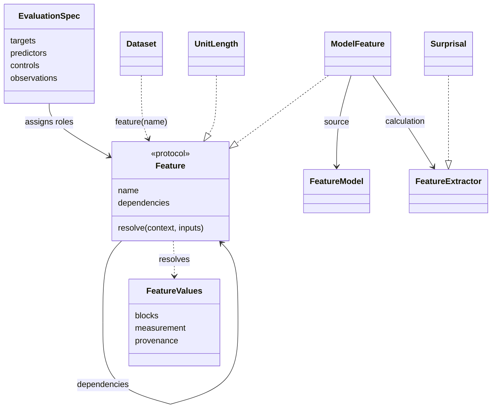

# Library architecture

REPLICA separates quantity definitions from statistical roles. A `Feature`
defines how to obtain an indexed quantity. `EvaluationSpec` assigns features to
targets, predictors and controls; `AnalysisConfig` defines fitting and scoring.
Study packages compose these parts into an experiment.

## Basic workflow

1. Load a `Dataset` containing stimuli and stored observations.
2. Define features from dataset quantities, model outputs or stimulus properties.
3. Assign their roles in an `EvaluationSpec`.
4. Call `evaluate(dataset, spec, config)` with `AnalysisConfig` for scalar targets
   or `EncodingConfig` for sampled targets.

```python
from replica import (
    EvaluationSpec, Lag, ModelFeature, Surprisal, UnigramSurprisal, UnitLength,
    WordfreqSource, evaluate,
)

# dataset and model are supplied by the caller.
surprisal = ModelFeature(model, Surprisal())
length = UnitLength()
unigram = UnigramSurprisal(WordfreqSource(dataset.info.language))
spec = EvaluationSpec(
    targets=[dataset.feature("first_fixation")],
    predictors=[surprisal, Lag(surprisal, 1), Lag(surprisal, 2)],
    controls=[
        length, Lag(length, 1), Lag(length, 2),
        unigram, Lag(unigram, 1), Lag(unigram, 2),
    ],
)
results = evaluate(dataset, spec)
```

The default scalar configuration fits a mixed-effects model to raw targets.
Study recipes select their own fitting settings explicitly. Their
`evaluation_spec(..., dataset=dataset)` binds the loaded source.
For sampled signals, select a measurement and modality, for example
`dataset.feature("bold", modality="fmri")`; hidden-state predictors are
`ModelFeature(model, HiddenState(layer))` instances.

## Quantities and observations



[`core.py`](../../src/replica/core.py) defines raw observations. `Stimulus` stores
text and named annotation layers using half-open character spans. `Datum` stores
values aligned to an annotation layer, optionally identified by participant.
`Recording` stores a sampled signal with its own clock and labelled value axes.
Missing values remain `NaN`.

[`contracts/features.py`](../../src/replica/contracts/features.py) defines the
shared feature protocol and indexed results below the dataset, feature and
analysis packages. `FeatureValues` contains read-only array blocks, observation
coordinates, optional measurement descriptions and provenance. Channels and
other value dimensions stay distinct from observation axes.

`dataset.feature(name)` selects a stored quantity. `fixation_feature(...)`
requests an explicit event calculation, checked against a native reference.
`ModelFeature(model, extractor)` binds an extractor such as `Surprisal()` to
its source. `UnitLength` and `LogFrequency` resolve directly from stimuli and
lexical sources. All of these are features and can occupy any statistical role
supported by the selected backend.

`FeatureMeasurement` describes a quantity, reporting unit and declared
parameters; it does not select or reconstruct a source. `MeasureSpec` and
`ResponseFamily` remain the dataset catalogue's measurement vocabulary.
Unknown measurement units stay unknown, including signal amplitudes whose
recording clocks are measured in seconds.

## Resolution and fitting

`resolve(dataset, feature)` resolves a quantity independently of evaluation.
The executor visits declared dependencies, rejects cycles and shares compatible
model requests within a call. It extracts features for one stimulus at a time
and releases its raw model outputs before processing the next stimulus.
Model output keys are scoped to their source.
Stored sources declare their native annotation layers. Unit calculations inherit
the selected targets' layers through their dependencies; an explicit segmentation
overrides this choice. Conflicting native layers require an explicit selection.
`Lag`, `Interaction`, `DerivedFeature` and `InUnit` compose indexed quantities.
For example, `InUnit(ModelFeature(model, Entropy()), "nats")` converts reporting
units without changing the underlying probabilities.

A target's native index defines the observation rows. In scalar analyses,
`observations=feature` selects an alternative index without using that feature's
values as a term or exclusion mask. A unique lookup may reuse unit-level values
on participant observations. Reducing participants or presentations requires
an explicit `aggregate(...)` operation. Matching labels alone do not establish
cross-dataset material or participant identity.

Lags operate before missing observations are filtered and stay within their
native stimulus and presentation boundaries. Derived quantities retain their
source contributors. Renaming a feature does not remove its lineage or permit
held-out target observations to enter predictors.
Custom resolvers with dependencies must set each output block's `origins`, or
return a resolved input unchanged. For a pointwise transformation, use
`block_origins(input_values, input_block)` from `replica.contracts.features`.
If rows are remapped or aggregated, declare the actual contributing source rows.
The executor preserves dependency origin registries and rejects omitted lineage;
it cannot detect undeclared scientific inputs or verify an explicit mapping.

Learned preprocessing belongs in `AnalysisConfig.preprocessing`.
`Residualize(feature, against=[...], policy="least_squares", intercept=True)`
fits a projection on training rows and subtracts it from both partitions.
The explicit `centered_slope` policy uses one centered covariance/variance
slope without an intercept. Residualization precedes the configured scaler. Baseline
and augmented models use the same retained observations and target transform.

`feature.diagnostics` compares predictors with reference targets and measures
sampling error. These runtime functions return numerical reports. Repository
checks under `scripts/checks` instead inspect source, metadata, and distribution
artifacts and return command-line findings.

[`evaluate()`](../../src/replica/analysis/evaluation/evaluate.py) resolves the feature graph,
aligns features and observations, and dispatches to the configured analysis.
Evaluation composes `analysis/data/preparation.py`, result types in
`analysis/contracts/results.py`, and fitting services in `analysis/fitting/`. These
components do not import evaluation, so callers can reuse preparation or
inference independently. Scalar analyses compare baseline and extended models
on matched observations.
Scaling and residualization are fitted within training folds. Sampled-response
analyses use `EncodingConfig`: normalization uses training statistics by default,
including the inner folds that select the ridge penalty. Reproduction recipes
can select `normalization="within_split"` explicitly. Results record the policy,
scoring scale and candidate penalties. `prepare_observations()` exposes aligned
scalar observations without fitting a model.

Maintained statistical models and splitters declare their options through
`configuration()`. Result metadata records those declarations; external
components without a declaration have an unknown configuration.

The [analysis guide](../../src/replica/analysis/README.md) describes the backends;
the [grouped analysis guide](grouped-analysis.md) explains model comparisons,
cross-validation and inference. These choices belong in explicit configurations
and study recipes. An outlier rule can be a built-in MAD/SD method or a callable
that returns a boolean mask over the finite raw responses of each group.
Filtering precedes the configured response transformation.

Validation distinguishes mathematical and structural requirements from
diagnostics. Malformed records and values outside a quantity's domain are
errors. Large finite values and partial missingness are review signals, not
universal scientific limits. A filename does not determine validity.

`InformationValueLM` uses all alternative pairs for expected-distance estimates.
Observed-target measures compare the target with each alternative. An explicit
`distance_limit` selects positional subsets for recipes that require them; the
output records that limit separately from the sample count.

## Package responsibilities

| Location | Responsibility |
|---|---|
| [`contracts/`](../../src/replica/contracts) | Feature protocol, indexed values and measurement descriptions shared across packages |
| [`dataset/`](../../src/replica/dataset) | Dataset contracts, metadata, acquisition, loaders and response definitions |
| [`feature/`](../../src/replica/feature) | Feature definitions, graph execution, model backends and predictor calculations |
| [`analysis/`](../../src/replica/analysis) | Observation preparation, designs, cross-validation, fitting and inference |
| [`compute/`](../../src/replica/compute) | Services and command adapters that generate and cache predictors |
| [`predictor_store/`](../../src/replica/predictor_store) | Export, validation and publication of predictor tables |
| [`predictors.py`](../../src/replica/predictors.py) | Readers for stored predictors and sampled outputs |
| [`studies/`](../../src/replica/studies) | Experiment recipes, study metadata, evidence and result services |
| [`multiverse/`](../../src/replica/multiverse) | Caller-configured comparisons, result schemas and specification-curve inference |
| [`external/`](../../src/replica/external) | Adapters for upstream repositories and their input layouts |
| [`utils/`](../../src/replica/utils) | Shared utilities, including atomic writes, hashes and source-import inspection |

The small modules at the package root own concepts shared across these
packages: `core.py` owns the data model, `segmentation.py` owns text units,
`context.py` owns preceding-context construction, `artifacts.py` owns predictor
manifest checks, and `paths.py` resolves writable locations. `cli.py` dispatches
application commands.

`__init__.py` exposes the public API through lazy imports. Importing `replica`
does not load every dataset or optional backend; accessing an exported name
loads its owning module. `__init__.pyi` describes those exports to static type
checkers, and `py.typed` marks the installed package as providing type information.

## Dataset organization

Within `dataset/`, `base.py` and `contracts.py` define shared interfaces.
`catalog/` owns discovery, descriptions and the bundled registry; `metadata/`
owns metadata loading and packaged YAML. `loading/` owns acquisition adapters,
content validation and fixation reaggregation. `measures/` owns response names
and their definitions. `locations.py` resolves data roots and shared companion-data
locations without discovering loaders. Modality packages (`eye_tracking/`, `spr/`, `eeg/`,
`fmri/`, and `maze/`) own concrete loaders. Resources stay beside their owning
code, including de Varda covariates and the ZuCo EEG loaders.

A custom dataset can supply the dataset interface directly to evaluation. A
catalog entry is needed when the caller wants registry discovery and CLI
selection; it is not required to analyze a caller-owned dataset object.

## Dependency boundaries

Reusable dataset, feature, analysis, compute and storage code must not import
study recipes, multiverse applications or the application CLI. Runtime package
code must not import tests or repository scripts. Smaller contracts have tighter
boundaries: predictor readers do not depend on producers; result indexes do not
depend on result storage or CLI adapters; dataset contracts do not depend on
individual loaders. Loaders resolve companion data without calling back into
the discovery registry, and diagnostics import feature implementations from
their owning modules rather than the public facade.

[`scripts/checks/source/architecture.toml`](../../scripts/checks/source/architecture.toml) defines
the shared import rules. A study's `architecture.toml` owns rules for that study.
The architecture checker (`python scripts/checks/source/import_boundaries.py`, also
run by `replica check`) checks explicit imports,
transitive restrictions and cycles. Computed imports and initialization behavior
also need runtime tests; a passing static graph is not proof of every possible
execution path.

Optional model and statistical integrations should load their dependencies
when needed. The base wheel must remain usable without Torch, Transformers,
R or a Rust extension. Dependency extras in
[`pyproject.toml`](../../pyproject.toml) select those integrations; an installed-wheel
smoke test exercises the base package outside a source checkout.

## Studies and evidence

Study discovery uses packages that contain both `__init__.py` and `README.md`.
The recipe defines its dataset, feature specification and analysis configuration;
its driver composes library services. Stage subpackages can hold reproduction,
repetition, replication and reanalysis work. Tests belong under
`tests/studies/<study>/`, with fixtures beside the study tests.

The packages present in a distribution determine what discovery exposes.
A recipe can be present without its evidence or result archive. Each study
that supplies claims owns its `claims.yaml` and `replication_results.yaml`;
shared registry loaders assemble the files that are present. Shared library
code must not infer that a discoverable recipe also supplies scientific results.

Citation checks use the bibliography in
[`tests/studies/fixtures/references.yaml`](../../tests/studies/fixtures/references.yaml).
This test fixture is independent of the installed study packages.

Result services under [`studies/records/`](../../src/replica/studies/records) keep
indexing, source provenance, storage and command dispatch separate. A result
index identifies artifacts and their immutable revisions and checksums.
Validation records describe compatibility with reviewed source; they do not
replace the original producer or constitute a new scientific run. The archive
and replay contracts are part of the development documentation.

## Application configuration

Core services accept explicit inputs; they do not select a cross-paper
campaign. [`ContrastRecipe`](../../src/replica/multiverse/run/replication/contrast.py)
describes predictors and accepts a model builder.
[`ReportSpec`](../../src/replica/multiverse/curve/report.py) declares comparison
dimensions and eligibility. Joint inference
requires per-observation deltas with matching cell and observation identities;
array length alone cannot establish alignment. Rowwise joint inference also
requires an explicit independent-observation assumption; crossed or clustered
responses need a grouped inference design. Missing or mismatched identities
must not silently become a joint result.

Result-row formatting is descriptive by default and requires the caller's model
identity. Inference requires an explicit callback; saving per-observation deltas
requires an explicit destination. Application wrappers can choose statistical
tests, random seeds and storage layouts without making those choices library
defaults.

The integration repository holds fixed corpus/model sweeps, cross-paper grids,
and validation/archive drivers. Those applications compose library services
and own their choices and dependency overlays. They are excluded from the
initial library export. Released studies remain in the dedicated
`replica.studies` package, with their settings, experiments and evidence. A
study can later move to its own distribution without teaching core services
its dataset list or model aliases.

Compute methods calculate predictors; compute drivers manage execution and
cache manifests. The CLI exposes supported adapters, while the Python
`FeatureModel` and `Feature` contracts accept caller implementations. The
bundled predictor catalog is a convenience for indexed artifacts, not the
only way to supply model outputs: `PrecomputedFeatureModel` accepts explicit
records. Generic diagnostics remain runtime APIs; paper-specific verification
catalogs belong with tests.

## Runtime data and packaging

Dataset metadata and declared package resources ship in the wheel. Downloaded
corpora, predictor caches and result archives use separate writable locations;
an installation should not write into `site-packages`. Environment overrides
and checkout or user-directory defaults are described in the
[environment guide](environment.md).

The PyPI source archive contains the package source and build resources. Use a
GitHub checkout for the complete contributor test suite, fixtures and audit
scripts.

Predictor manifests bind stored values to their configuration and bytes.
Study result indexes additionally track the scientific producer and validation
history. Prepared-analysis checkpoints also bind their source implementation. A module
move changes that identity: resume an old checkpoint with its recorded source
and environment, or start a fresh checkpoint under the new source.
The current compute cache fingerprint conservatively includes all package source,
so an unrelated source move can also trigger recomputation. Matching output
values does not make an old cache identity valid under a new source tree.

## Extending and checking the library

| Change | Implementation and checks |
|---|---|
| Dataset | Supply the dataset interface; add acquisition metadata and a catalog entry for bundled discovery; test alignment and response definitions with small fixtures |
| Feature | Implement the feature protocol and output requirements; test unit alignment, unavailable outputs and the numerical definition |
| Backend | Implement the relevant model protocol; test training versus held-out behavior and optional-dependency failures |
| Study | Add its recipe, README, stage work and study-owned tests; use independent references for scientific claims |
| Stored artifact | Update the producer or reader contract and test stale identities, corrupt bytes and interrupted writes |

Use `replica check` for static contributor checks. The
[test guide](../../tests/README.md) defines fast and regression tiers, resource
markers and independent reference tests.

## Object reference

These are the shared contracts, configurations and result containers. Concrete
corpus loaders and estimator implementations specialize the listed interfaces.
Import locations identify the owning API; some names are also exported from
`replica`.

| Role | Objects | Import location |
|---|---|---|
| Text and aligned annotations | `Span`, `AnnotationLayer`, `Stimulus` | `replica.core` |
| Observed responses | `Datum` (participant response vector), `Recording` (sampled, potentially multichannel response) | `replica.core` |
| Acquisition and presentation categories | `Modality`, `Presentation` | `replica.core` |
| Annotation units | `Segmenter`, `WhitespaceSegmenter`, `CharacterSegmenter` | `replica.segmentation` |
| Token-to-unit mapping | `TokenAlignment` | `replica.feature` |
| Dataset interfaces | `Dataset`, `ReadingTimeDataset`, `EyeTrackingDataset`, `SPRDataset`, `EEGDataset`, `MazeDataset` | `replica.dataset` |
| Caller-provided tables | `TabularDataset`, `TabularDatasetConfig` | `replica.dataset` |
| Corpus and file metadata | `DatasetInfo`, `FileEntry`, `IndexMapping` | `replica.dataset` |
| Dataset discovery descriptions | `DatasetDescription`, `DatasetParameter`, `DatasetVariant` | `replica.dataset` |
| Registered loader construction | `DatasetRegistration` | `replica.dataset.catalog.registry` |
| Individual fixation events | `Fixation` | `replica.dataset.contracts` |
| Stored quantities and event calculations | `dataset.feature(...)`, `fixation_feature(...)` | `replica.dataset` |
| Canonical response descriptions | `MeasureSpec`, `ResponseFamily` | `replica.dataset.measures` |
| Response source declarations | `MeasureSource` | `replica.dataset.measures.sources` |
| Fixation-derived response rules | `FixationCalculation` | `replica.dataset` |
| Feature producers and output records | `FeatureModel`, `FeatureModelOutput` | `replica.feature` |
| Quantity definitions and extraction | `Feature`, `FeatureExtractor`, `ModelFeature`, `FrequencySource` | `replica.feature` |
| Indexed quantity results | `FeatureValues`, `FeatureBlock`, `FeatureIndex` | `replica.contracts.features` |
| Feature quantity, reporting unit and parameters | `FeatureMeasurement` | `replica.feature` |
| Feature composition | `InUnit`, `Lag`, `Interaction`, `DerivedFeature`, `aggregate` | `replica.feature` |
| Retained model outputs | `PrecomputedFeature`, `PrecomputedFeatureModel` | `replica.feature` |
| Learned preprocessing | `Residualize` | `replica.analysis` |
| Model composition and context | `MergedFeatureModel`, `PrecedingContextModel` | `replica.feature` |
| Model start/context defaults | `ModelDefaults` | `replica.feature.backends.model_defaults` |
| Evaluation inputs and comparisons | `EvaluationSpec`, `ComparisonSpec` | `replica.analysis` |
| Scalar and sampled-response policies | `AnalysisConfig`, `EncodingConfig` | `replica.analysis` |
| Named statistical design | `Design`, `Factor`, `RandomEffect` | `replica.analysis` |
| Prepared observations and selected model frames | `ObservationTable`, `GroupedFrame` | `replica.analysis` |
| Train/test splits | `CVSplitter`, `CrossedGroupSplitter`, `ItemSplitter`, `RowSplitter`, `ShuffledKFoldSplitter`, `SequentialBlockSplitter`, `SubjectSentenceMod10Splitter`, `FixedSplitter`, `FullDataSplitter`, `MultiSeedSplitter` | `replica.analysis` |
| Filtering and fitted transformations | `OutlierFilter`, `Scaler`, `ZScoreScaler`, `MinMaxScaler`, `NoScaler`, `FoldTransform`, `Residualize` | `replica.analysis` |
| Statistical backend interfaces | `AnalysisModel`, `LikelihoodModel`, `GroupedModel`, `StatsPredictor` | `replica.analysis` |
| Backend outputs | `GroupedFit`, `FoldScore` | `replica.analysis` |
| Evaluation results | `AnalysisResult`, `FoldResult`, `Coefficient`, `EncodingResult`, `EncodingFoldArtifact` | `replica.analysis` |
| Inference settings and results | `CrossedBootstrapConfig`, `PredictiveTestResult`, `GroupedPermutationResult` | `replica.analysis` |
| Predictor computation | `ComputeContext`, `ComputeOutcome`; `MethodSpec` | `replica.compute`; `replica.compute.methods` |
| Predictor artifact and decoded identity | `Cell`; `TagInfo` | `replica.predictor_store.cells`; `replica.predictor_store.layout` |
| Pinned external input | `DataDependency` | `replica.external` |
| Study recipes | `Study`; `TabularStudy`, `TabularRecipe` | `replica.studies`; `replica.studies.base` |
| Caller-defined campaign coordinates and contracts | `DatasetCell`; `ReplicationSpec`, `CellRunner`; `ContrastRecipe`; `ReportSpec` | `replica.multiverse.spec`; `replica.multiverse.run.replication.contracts`; `replica.multiverse.run.replication.contrast`; `replica.multiverse.curve.report` |

The main execution functions are `evaluate`, `prepare_observations`, `benchmark`,
`predictive_test`, `crossed_bootstrap_test` and `grouped_permutation_test` in
`replica.analysis`. Predictor persistence and study evidence use functions and
structured manifests in `replica.predictors`, `replica.artifacts`,
`replica.predictor_store` and `replica.studies.records`.

Several names describe different stages: `DatasetInfo` describes a corpus,
`DatasetRegistration` constructs a registered loader, and `DatasetDescription` describes
its available options. `ObservationTable` holds prepared observations;
`GroupedFrame` selects one model's terms. `Residualize` declares a projection
that is fitted within each training fold. `AnalysisResult` is a result container.
Annotation units such as words are distinct from reporting units such as nats.

